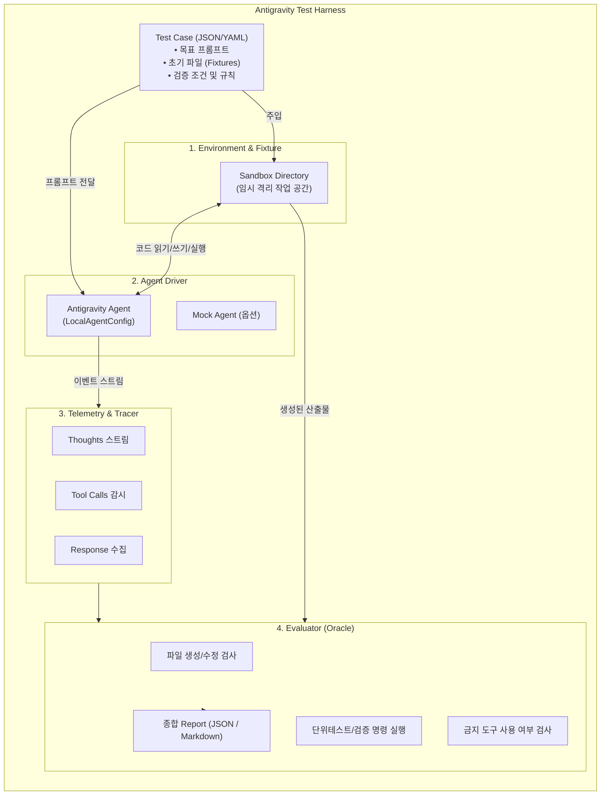

# Antigravity 하네스(Harness) 구조 설계 및 구현 가이드

소프트웨어 공학 및 AI 에이전트 환경에서 **하네스(Harness)**는 시스템을 둘러싸고 **입력 주입, 격리된 환경 제어, 도구 실행 감시, 결과물 자동 검증 및 평가**를 수행하는 일체형 프레임워크를 의미합니다.

Google Antigravity 생태계에서는 하네스를 다음 두 가지 관점으로 구현 및 운용할 수 있습니다:
1. **에이전트 평가/테스트 하네스 (Agent Evaluation & Test Harness)**: Python SDK(`google-antigravity`)를 통해 에이전트에 태스크를 주입하고, 격리된 샌드박스에서 수행 능력(코드 작성, 도구 호출, 단위 테스트 통과)을 자동 채점/벤치마킹하는 외부 프레임워크.
2. **워크스페이스 런타임 하네스 (In-Project Guardrails Harness)**: 프로젝트 내 `hooks.json`과 Rules를 통해 에이전트의 도구 호출을 가로채고(Interception), 린트 및 보안 규칙을 강제하는 내부 제어 프레임워크.

---

## 1. 하네스 아키텍처 개요



---

## 2. 핵심 4대 계층 설계

### (1) Test Driver (테스트 드라이버)
- `google.antigravity`의 `Agent`, `LocalAgentConfig`, `CapabilitiesConfig`를 활용하여 에이전트의 전체 수명주기를 제어합니다.
- `agent.chat(prompt)` 호출 후 반환되는 비동기 스트림을 통해 **모델의 사고 과정(Thoughts)**, **도구 실행(Tool Calls)**, **응답 토큰**을 실시간으로 가로채어 기록합니다.
- 타임아웃 및 이상 종료 처리를 관할합니다.

### (2) Environment / Fixture (환경 격리 및 픽스처)
- 테스트 대상 에이전트가 시스템 파일이나 메인 프로젝트를 오염시키지 않도록 `tempfile` 기반의 격리된 샌드박스를 구성합니다.
- 사전 준비된 베이스 코드, 단위 테스트 파일, 설정 파일 등 초기 픽스처(Initial Files)를 디렉터리에 자동 배치합니다.
- 테스트 완료 후 디버그 플래그(`preserve=True`)에 따라 샌드박스를 보존하거나 안전하게 정리합니다.

### (3) Telemetry & Tracer (관측 및 계측)
- 에이전트가 어떤 도구를 어떤 인자로 호출했는지(`ToolCallRecord`), 보안 상 위험하거나 금지된 도구를 호출하지 않았는지 추적합니다.
- 추론 단계별 소요 시간 및 전체 태스크 소요 시간을 측정합니다.

### (4) Evaluator / Oracle (결과 판정기)
- **파일 무결성 검증**: 기대한 파일(`expected_files`)이 생성/수정되었는지 검사.
- **실행 기반 검증**: `verification_command`(예: `pytest`, `python test.py`)를 샌드박스 내부에서 서브프로세스로 구동하여 exit code 0 및 assertions 통과 여부 검증.
- **안전성 규칙 검사**: `disallowed_tools`에 정의된 도구 호출이 발생했는지 감지.

---

## 3. 구현된 프로젝트 구조

`C:\Users\HODI\.gemini\antigravity\scratch\antigravity_harness` 경로에 실제 구동 가능한 하네스가 구현되어 있습니다:

```
antigravity_harness/
├── cases/
│   └── example_case.json       # 테스트 시나리오 정의 (프롬프트, 픽스처, 검증 명령어)
├── harness/
│   ├── __init__.py
│   ├── environment.py          # TestCase 데이터 모델 및 Sandbox 환경 관리
│   ├── driver.py               # Antigravity SDK 구동 및 Mock 폴백 드라이버
│   ├── security.py             # Fernet 기반 대칭키 암복호화 및 .env 자동 주입기
│   ├── telemetry.py            # 사고/도구호출/응답 수집기
│   └── evaluator.py            # 결과 검증 및 Markdown 리포터
├── manage_secret.py            # GEMINI_API_KEY 암호화 및 비밀값 관리 CLI 도구
├── run_harness.py              # CLI 실행 엔트리포인트 (보안 환경변수 자동 로드)
├── .env                        # 암호화된 API 키 보관 (enc:... 형태)
├── .secret.key                 # 마스터 대칭키 (Git 제외)
└── harness_report.json         # 실행 결과 JSON 리포트
```

### 테스트 케이스 정의 예시 (`cases/example_case.json`)
```json
{
  "id": "algo-01-unique-sorted",
  "description": "숫자 리스트 중복 제거 및 정렬 함수 구현 과제",
  "prompt": "test_solution.py에 작성된 단위 테스트를 통과하도록 solution.py에 unique_sorted(numbers) 함수를 구현하고 저장하세요.",
  "initial_files": {
    "test_solution.py": "from solution import unique_sorted\n\ndef test_unique_sorted():\n    assert unique_sorted([3, 1, 2, 3, 2, 1]) == [1, 2, 3]\n    assert unique_sorted([]) == []\n    assert unique_sorted([5, 5, 5]) == [5]\n    print('ALL TESTS PASSED')\n\nif __name__ == '__main__':\n    test_unique_sorted()\n"
  },
  "expected_files": [
    "solution.py"
  ],
  "verification_command": "python test_solution.py",
  "disallowed_tools": [],
  "timeout_seconds": 60
}
```

---

## 4. 워크스페이스 레벨 런타임 하네스 (Lifecycle Hooks)

외부에서 에이전트를 테스트하는 것 외에도, 프로젝트 개발 중에 에이전트가 안전하고 일관된 코드를 작성하도록 강제하는 **내부 가드레일 하네스**를 구축할 수 있습니다.

`.agents/hooks.json` 파일을 통해 도구 호출 전/후에 검사 스크립트를 연결합니다:

```json
{
  "project-harness-guard": {
    "PreToolUse": [
      {
        "matcher": "run_command",
        "hooks": [
          {
            "type": "command",
            "command": "python scripts/guard_check.py",
            "timeout": 10
          }
        ]
      }
    ],
    "PostToolUse": [
      {
        "matcher": "write_to_file",
        "hooks": [
          {
            "type": "command",
            "command": "python -m flake8",
            "timeout": 15
          }
        ]
      }
    ]
  }
}
```

- **`PreToolUse` (위험 명령 차단)**: `rm -rf`, `drop database` 등의 파괴적 명령어 실행 사전 차단.
- **`PostToolUse` (품질 검증 자동화)**: 코드 파일 생성/수정 직후 린터(Linter) 및 포맷터(Formatter)를 자동 구동하여 실패 시 에이전트 피드백 루프로 전달.

---

## 5. 실행 및 테스트 방법

### 1) Mock 모드로 하네스 무결성 확인
Antigravity SDK 설치 전이라도 파이프라인 전체 동작(샌드박스 생성 -> 픽스처 주입 -> 실행 -> 검증 -> 리포팅)을 즉시 테스트할 수 있습니다:
```bash
cd C:\Users\HODI\.gemini\antigravity\scratch\antigravity_harness
$env:PYTHONIOENCODING="utf-8"
python run_harness.py --mock
```

### 2) 실제 Antigravity Agent와 연동 실행
```bash
pip install google-antigravity
python run_harness.py --cases-dir cases/
```

---

## 6. GEMINI_API_KEY 암호화 및 보안 관리 가이드

API 키가 평문으로 노출되는 것을 방지하기 위해 `cryptography.fernet`(AES-128-CBC + HMAC) 기반의 암호화 체계를 지원합니다.

### 1) 마스터 키 신규 생성
```bash
python manage_secret.py init-key
```
- 프로젝트 루트에 `.secret.key`가 생성됩니다. (Git 제외 대상)
- CI/CD 환경 등에서는 파일 대신 시스템 환경변수 `HARNESS_MASTER_KEY`로 주입할 수도 있습니다.

### 2) GEMINI_API_KEY 암호화 저장
대화형으로 안전하게 API 키를 입력받아 `.env` 파일에 암호화하여 저장합니다:
```bash
python manage_secret.py set GEMINI_API_KEY
```
- `.env` 파일에는 `GEMINI_API_KEY=enc:gAAAAAB...` 형태로 저장됩니다.

### 3) 저장된 환경변수 복호화 검증
```bash
python manage_secret.py verify
```

### 4) 하네스 실행 시 자동 복호화 주입
`run_harness.py` 실행 시 보안 모듈이 자동으로 `.env`의 `enc:` 접두사를 감지하여 메모리 상의 `os.environ['GEMINI_API_KEY']`로 투명하게 복호화 주입합니다.
